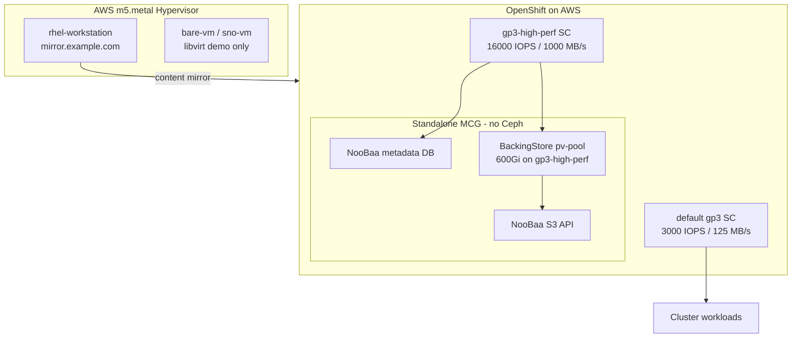
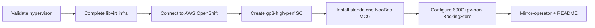

# Mirror Operator Demo — What We Can Do

## What This Project Is

An Ansible project with two layers:

1. **Hypervisor lab** — KVM on AWS `m5.metal` for disconnected mirror workstation + libvirt demo VMs
2. **OpenShift on AWS** — real cluster with default gp3 StorageClass; standalone NooBaa (MCG-only) for object storage



**Current state:** Hypervisor inventory at `18.218.36.100`. No OpenShift/NooBaa playbooks yet. No README or git repo.

---

## OpenShift + Standalone NooBaa on AWS (primary storage plan)

### Design decisions (confirmed requirements)

| Requirement | Approach |
|---|---|
| Cluster on AWS | Connect via kubeconfig; use AWS EBS CSI (`ebs.csi.aws.com`) |
| Default gp3 exists | Leave default SC for general workloads — do not modify |
| Higher IOPS/bandwidth | Create **`gp3-high-perf`** StorageClass with tuned `iops` + `throughput` |
| ODF for NooBaa | **Standalone MCG only** (`reconcileStrategy: standalone`) — no Ceph, no LSO |
| 500GB+ NooBaa capacity | `BackingStore` `pv-pool` with `numVolumes × volumeSize ≥ 500Gi` on `gp3-high-perf` |
| No S3 passthrough | Data buckets via `BackingStore` only — no `NamespaceStore` |
| No local / full ODF | Exclude LSO, LocalVolumeSet, Ceph `storageDeviceSets` |

### What "no S3 passthrough" means

- **Do use:** `BackingStore` type `pv-pool` — NooBaa stores encrypted chunks on EBS PVCs
- **Do not use:** `NamespaceStore` / namespace bucket classes
- **Do not use:** `BackingStore` type `aws-s3` pointing at external AWS S3 buckets

---

### Step 1 — Connect to AWS OpenShift cluster

Playbook: `playbooks/openshift/connect-cluster.yml`

```yaml
# group_vars/all.yml additions
ocp_kubeconfig: "{{ playbook_dir }}/../files/kubeconfig"
ocp_api_url: ""                    # optional, e.g. https://api.cluster.example.com:6443
ocp_verify_ssl: true
ocp_default_sc_name: gp3-csi        # detected at runtime; fallback for default gp3 SC
```

Tasks:
- Validate kubeconfig; `kubernetes.core.k8s_info` for API reachability
- `oc get nodes`, `oc get co` — cluster health
- `oc get sc` — detect default gp3 StorageClass name
- Record OCP version for ODF channel (`stable-4.XX`)

---

### Step 2 — Create high-performance gp3 StorageClass

Playbook: `playbooks/openshift/create-gp3-high-perf-sc.yml`

Template: `templates/gp3-high-perf-storageclass.yaml.j2`

```yaml
apiVersion: storage.k8s.io/v1
kind: StorageClass
metadata:
  name: {{ gp3_high_perf_sc_name }}
  annotations:
    storageclass.kubernetes.io/is-default-class: "false"
provisioner: ebs.csi.aws.com
parameters:
  type: gp3
  iops: "{{ gp3_high_perf_iops }}"           # default: "16000"
  throughput: "{{ gp3_high_perf_throughput }}" # default: "1000" MB/s
  encrypted: "true"
volumeBindingMode: WaitForFirstConsumer
allowVolumeExpansion: true
reclaimPolicy: Delete
```

Variables:

```yaml
gp3_high_perf_sc_name: gp3-high-perf
gp3_high_perf_iops: "16000"
gp3_high_perf_throughput: "1000"
```

---

### Step 3 — Install ODF operator + standalone MCG (NooBaa only)

Playbook: `playbooks/openshift/install-noobaa-standalone.yml`

```yaml
apiVersion: ocs.openshift.io/v1
kind: StorageCluster
metadata:
  name: ocs-storagecluster
  namespace: openshift-storage
spec:
  resourceProfile: lean
  multiCloudGateway:
    reconcileStrategy: standalone        # NooBaa only — NO Ceph
    dbStorageClassName: gp3-high-perf
    disableLoadBalancerService: false
  # intentionally NO storageDeviceSets
```

Wait: `oc wait storagecluster/ocs-storagecluster -n openshift-storage --for=condition=Available --timeout=20m`

**Result:** NooBaa S3 endpoint + `openshift-storage.noobaa.io` SC. **No** Ceph OSDs or `ocs-storagecluster-ceph-rbd`.

---

### Step 4 — Configure NooBaa BackingStore (500GB+, pv-pool)

Playbook: `playbooks/openshift/configure-noobaa-backing-store.yml`

1. Patch NooBaa for manual backing store control:
   ```bash
   oc patch noobaa/noobaa -n openshift-storage --type=merge \
     -p '{"spec":{"manualDefaultBackingStore":true}}'
   ```

2. Create high-perf backing store (600Gi = 3 × 200Gi):

```yaml
apiVersion: noobaa.io/v1alpha1
kind: BackingStore
metadata:
  name: noobaa-high-perf-pool
  namespace: openshift-storage
  finalizers:
  - noobaa.io/finalizer
spec:
  type: pv-pool
  pvPool:
    numVolumes: 3
    storageClass: gp3-high-perf
    resources:
      requests:
        storage: 200Gi
      limits:
        memory: 4Gi
```

3. Patch default BucketClass:
   ```bash
   oc patch bucketclass noobaa-default-bucket-class -n openshift-storage --type=merge \
     -p '{"spec":{"placementPolicy":{"tiers":[{"backingStores":["noobaa-high-perf-pool"],"placement":"Spread"}]}}}'
   ```

4. Delete auto-created default backing store once new store is Ready.

Variables:

```yaml
noobaa_backing_store_name: noobaa-high-perf-pool
noobaa_pv_pool_num_volumes: 3
noobaa_pv_pool_volume_size: 200Gi
noobaa_min_total_capacity_gi: 500
```

---

### Step 5 — Validation

Playbook: `playbooks/openshift/validate-odf-noobaa.yml`

```bash
oc get sc gp3-high-perf
oc get pods -n openshift-storage | grep noobaa
oc get backingstore -n openshift-storage
oc get namespacestore -n openshift-storage   # must be empty
oc -n openshift-storage exec deploy/noobaa-operator -- noobaa status
```

---

### Ansible playbook structure (to create)

```
playbooks/openshift/
  connect-cluster.yml
  create-gp3-high-perf-sc.yml
  install-noobaa-standalone.yml
  configure-noobaa-backing-store.yml
  validate-odf-noobaa.yml

templates/
  gp3-high-perf-storageclass.yaml.j2
  noobaa-backing-store.yaml.j2
  noobaa-storagecluster-standalone.yaml.j2
```

Run order:

```bash
ansible-playbook playbooks/openshift/connect-cluster.yml
ansible-playbook playbooks/openshift/create-gp3-high-perf-sc.yml
ansible-playbook playbooks/openshift/install-noobaa-standalone.yml
ansible-playbook playbooks/openshift/configure-noobaa-backing-store.yml
ansible-playbook playbooks/openshift/validate-odf-noobaa.yml
```

---

### Cost / sizing notes

- gp3 at 16000 IOPS + 1000 MB/s costs more than default gp3
- 600Gi EBS for NooBaa pv-pool + small metadata DB PVC
- `WaitForFirstConsumer` keeps volumes in the same AZ as NooBaa pods
- `allowVolumeExpansion: true` if capacity needs to grow beyond 500Gi

---

## What's Already Built (hypervisor playbooks)

| Playbook | Purpose |
|---|---|
| [playbooks/provision-ec2.yml](playbooks/provision-ec2.yml) | Launch `m5.metal` in `*.opentlc.com` VPC |
| [playbooks/configure-host.yml](playbooks/configure-host.yml) | KVM, Cockpit, GNOME, VNC, NTP, DNS |
| [playbooks/create-storage.yml](playbooks/create-storage.yml) | libvirt storage pool |
| [playbooks/create-networks.yml](playbooks/create-networks.yml) | Isolated libvirt network |
| [playbooks/create-fedora-vm.yml](playbooks/create-fedora-vm.yml) | RHEL 9 workstation (misnamed) |
| [playbooks/create-bare-vm.yml](playbooks/create-bare-vm.yml) | Empty UEFI VM (libvirt demo) |
| [playbooks/create-sno-vm.yml](playbooks/create-sno-vm.yml) | SNO demo VM |
| [playbooks/setup-redfish.yml](playbooks/setup-redfish.yml) | sushy-emulator Redfish API |

---

## Recommended Path



1. Complete hypervisor / mirror workstation infra on `18.218.36.100`
2. Connect to AWS OpenShift via kubeconfig
3. Create `gp3-high-perf` StorageClass (separate from default gp3)
4. Deploy standalone NooBaa (no Ceph)
5. Configure 500GB+ `pv-pool` BackingStore on `gp3-high-perf`
6. Build mirror-operator layer using NooBaa S3 endpoint
7. Document with README and `site.yml`

---

## Key Config Reference

Hypervisor ([group_vars/all.yml](group_vars/all.yml)):
- EC2: `m5.metal`, 1.5TB gp3 root volume
- RHEL VM: 8 vCPU, 32GB RAM, 750GB disk at `192.168.100.10`
- Isolated network: `192.168.100.0/24`

AWS OpenShift + NooBaa (to add to group_vars):
- `gp3_high_perf_sc_name`, `gp3_high_perf_iops`, `gp3_high_perf_throughput`
- `noobaa_backing_store_name`, `noobaa_pv_pool_num_volumes`, `noobaa_pv_pool_volume_size`
- `ocp_kubeconfig`, `odf_operator_channel`
